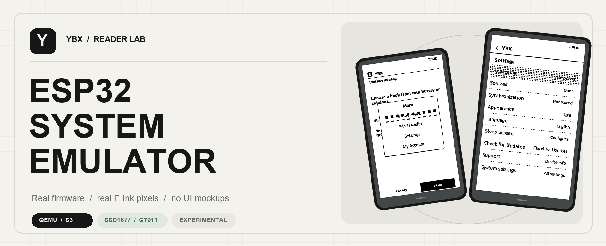
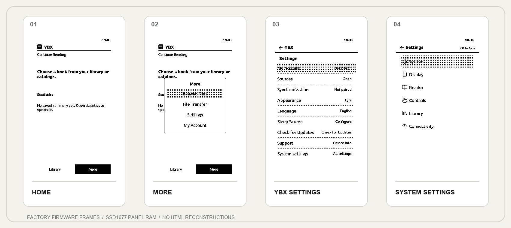
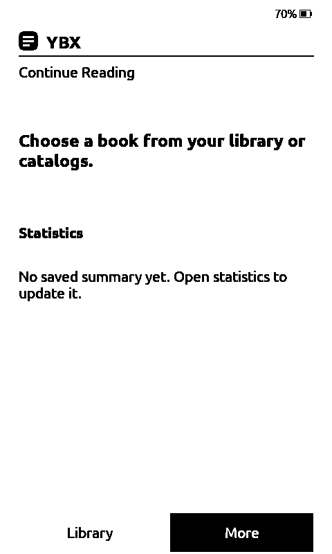
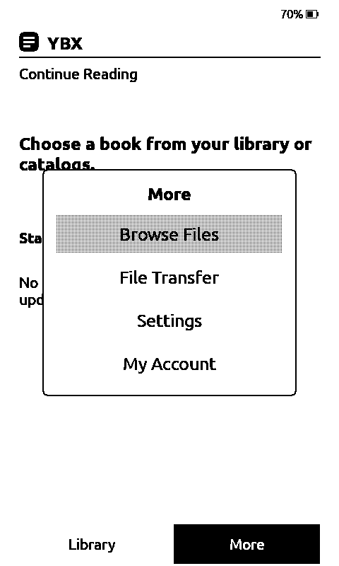
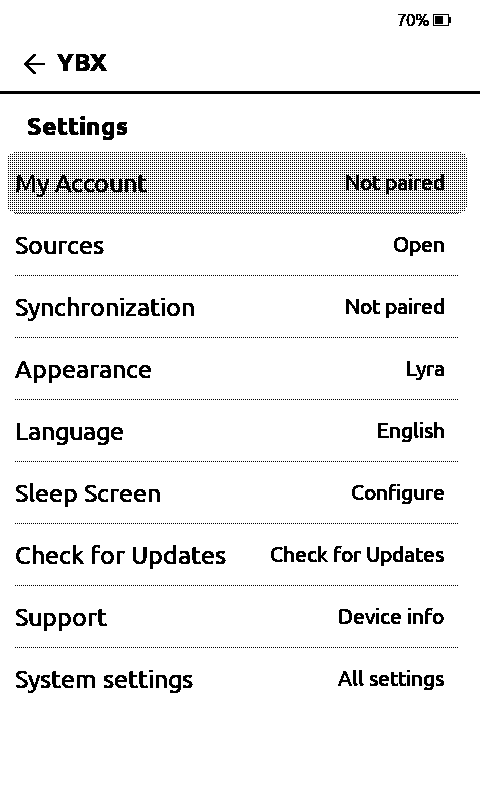
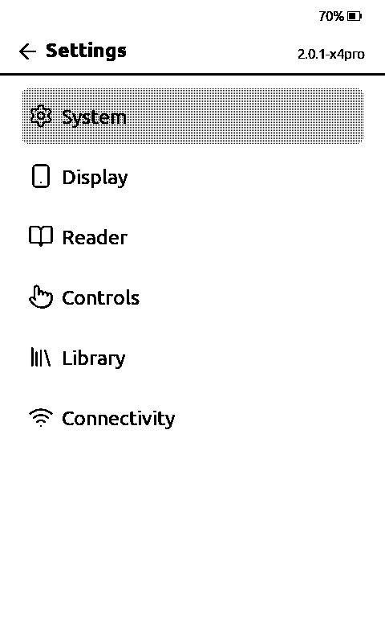
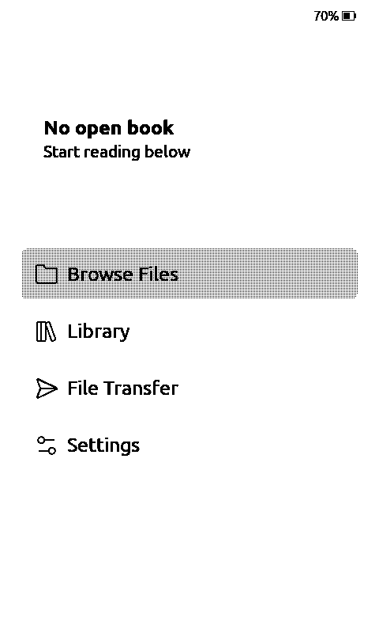
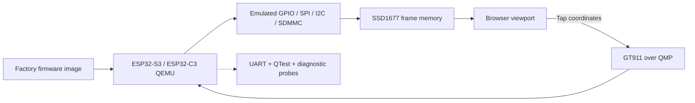

<div align="center">



### Run the reader. See the pixels. Debug the hardware.

**A full-system ESP32 emulator for E-Ink readers — built on QEMU, running real firmware and capturing the actual panel framebuffer.**

[](https://github.com/jhdvp/ybx-crosspoint)


[](https://github.com/jhdvp/ybx-esp32-emulator/actions/workflows/host-tests.yml)

[](LICENSING.md)

[**Screenshots**](#real-firmware-screenshots) · [**Hardware status**](#emulation-status) · [**Get started**](#getting-started) · [**Architecture**](#how-it-works) · [**Roadmap**](#roadmap) · [**Status snapshot**](STATUS.md)

</div>

---

## Real firmware screenshots

<p align="center"></p>

<p align="center"><sub>The first four images come from the real, unmodified YBX X4 Pro firmware; the fifth is stock CrossPoint 2.0.0rc booted in the same emulator. All of them are derived from the emulated SSD1677 display RAM — not HTML recreations, static UI mockups or a physical reader.</sub></p>

<details>
<summary><strong>Open individual full-resolution 480 × 800 captures</strong></summary>

| Home | More | YBX Settings | System Settings | Stock CrossPoint 2.0 |
|:---:|:---:|:---:|:---:|:---:|
|  |  |  |  |  |

</details>

## Emulation status

> [!IMPORTANT]
> **Research-grade emulator, not hardware-complete.** Booting a firmware image is not the same thing as faithfully simulating every ESP32 peripheral. The status below distinguishes measured behavior from missing functionality.

| System | Status | Evidence / limitation |
|:--|:--|:--|
| ESP32-S3 Xtensa LX7 | 🟢 **Working** | Original bootloader and X4 Pro factory application execute in QEMU |
| ESP32-C3 RISC-V | 🟡 **Partial** | Real ROM/boot/application execution verified; peripheral coverage is incomplete |
| SSD1677 E-Ink 800 × 480 | 🟢 **Working (basic)** | Actual framebuffer writes, 480 × 800 oriented PNG capture and screen transitions |
| GT911 touch controller | 🟢 **Working (basic)** | Virtual touch/release through QMP; factory UI reacts to real guest events |
| GPIO6 / panel BUSY / IRQ | 🟢 **Working (instrumented)** | CPU interrupt routing, BUSY edge/duration counters; reset-order defect fixed and re-verified on factory firmware ([0051](tools/ybx-system-emu/experiments/0051-busy-telemetry-reset-verification-20261030.md)) |
| SDMMC / FAT media | 🟡 **Partial** | SDMMC DMA reads and selected FAT image workflows verified; not full card parity |
| Browser interface | 🟢 **Working** | Live display, touch injection, reset, QEMU crash recovery, read-only `/api/telemetry`, ETag caching, bounded tap queue |
| ROM / firmware pickers | 🟢 **Working** | Choose the guest ROM and the guest firmware image from read-only folders on the Mac; the active image, its SHA-256 and its provenance are shown, and a custom build is never presented as the factory image ([0066](tools/ybx-system-emu/experiments/0066-batch3-rom-selection.md), [0067](tools/ybx-system-emu/experiments/0067-batch3-firmware-picker-20261031.md)) |
| GUI navigation acceptance | 🟢 **Working** | Home → More → YBX Settings → System settings → Back verified against the running guest with per-step SSD1677 SHA gates ([0062](tools/ybx-system-emu/experiments/0062-batch3-nav-automation.md)) |
| Patched QEMU build | 🟢 **Reproducible (composition)** | The audited chain composes deterministically from the pinned base `febae18` with a signed manifest; the container build is opt-in and not yet executed end to end ([0063](tools/ybx-system-emu/experiments/0063-batch3-repro-build.md)) |
| Upstream CrossPoint / inkMOD images | 🟡 **Boots (CrossPoint)** | Stock CrossPoint 2.0.0rc and 1.6.5 boot and paint their own UI after the 0068 PSRAM bounds fix; inkMOD starts but paints nothing ([0068](tools/ybx-system-emu/experiments/0068-bootloader-flash-boot-matrix-20261031.md)) |
| Wi-Fi / 802.11 MAC + PHY | 🔴 **Not emulated** | Factory register accesses are pinned and an opt-in non-fake stub is proposed ([0060](tools/ybx-system-emu/experiments/0060-batch3-wifi-radio.md)); no scan, association, address, frame or TLS is produced |
| TLS and cloud services | ⚪ **Unverified** | No verified end-to-end guest TLS session; do not infer it from host networking |
| Power / sleep / waveform timing | 🟢 **Modelled** | Host lifecycle models and telemetry, not physical E-Ink fidelity; split power/waveform BUSY windows, a real deep-sleep state and BUSY around reset are in the running kernel ([0069](tools/ybx-system-emu/experiments/0069-epd-waveform-apply-20261031.md)) |
| X3 / X4 / other panels | 🟡 **Early bring-up** | CPU milestones exist; full interactive device coverage is not claimed |

**Evidence:** standalone run: 648 tests (637 passed, 11 skipped). With the companion CrossPoint firmware source tree: 672 tests (662 passed, 10 skipped). These counts describe verified local runs, not hardware-complete emulation. The workflow badge above reports independent GitHub Actions status. Every claim made by the twelve research agents that built this emulator was re-checked against code, QTest and the running factory guest in [0052](tools/ybx-system-emu/experiments/0052-six-agent-verification-pass-20261030.md).

## How it works



The browser reads the actual 1-bit emulated panel framebuffer. Touch coordinates travel back into the virtual GT911 controller. **The guest firmware, not the website, decides which screen appears.**

## Getting started

<details open>
<summary><strong>1. Prerequisites</strong></summary>

- macOS with Docker Desktop, Python 3.10+ and Git (the current development host is Apple Silicon).
- A compatible, locally built **Espressif QEMU** checkout with the tested X4 Pro patches. No emulator binary is committed here.
- Your own legally obtained ESP32-S3 factory ROM / merged flash image and SD card image. No factory firmware or private credentials are distributed.

</details>

<details open>
<summary><strong>2. Clone and test the host tooling</strong></summary>

```bash
git clone https://github.com/jhdvp/ybx-esp32-emulator.git
cd ybx-esp32-emulator
python3 -m unittest discover -s tools/ybx-system-emu -p 'test_*.py'

# Optional: validate real Wi-Fi state-machine code from your firmware checkout:
YBX_FIRMWARE_ROOT="$HOME/Projects/YBX/CrossPoint-firmware" \
  python3 -m unittest discover -s tools/ybx-system-emu -p 'test_*.py'
```

</details>

<details open>
<summary><strong>3. Start the browser with your local QEMU and images</strong></summary>

```bash
# These paths are intentionally external to the Git repository.
export YBX_QEMU_ROOT="$HOME/path/to/patched-qemu"
export YBX_QA_DIR="$HOME/path/to/your-firmware-images"
export YBX_BROWSER_BIND_ADDRESS=127.0.0.1
export YBX_BROWSER_PORT=8784

# YBX_QA_DIR must contain:
#   s3-full-rom-generator-test.bin
#   s3-flash-complete-rom-test.bin
#   ybx-test-sd-fat16-mbr-pristine.img

docker build -f tools/ybx-system-emu/Dockerfile.qemu -t ybx-qemu-builder:20261029 .
bash tools/ybx-system-emu/start_x4pro_browser.sh
```

Open **http://127.0.0.1:8784/**. The launcher checks required files and avoids exposing its unauthenticated API on public IP addresses. This is a *bring-up workflow*, not yet a one-command emulator installer. For hardware evidence and the patch chain, read [`QEMU_BRINGUP.md`](tools/ybx-system-emu/QEMU_BRINGUP.md) and [`experiments/README.md`](tools/ybx-system-emu/experiments/README.md).

</details>

## What's inside

```text
assets/                   ← genuine firmware captures + README artwork
scripts/                  ← gallery renderer
tools/ybx-system-emu/
    serve_x4pro_browser.py    ← live browser + QMP bridge (+ /api/telemetry)
    start_x4pro_browser.sh    ← Docker launcher
    probe_*.py                ← CPU/peripheral acceptance probes
    test_*.py                 ← host regression suite
    check_qemu_patch_composition.py  ← audited chain + provenance checker
    build_reproducible_qemu.sh       ← clean-room chain composition and build
    run_x4pro_guest_navigation.py    ← multi-step GUI acceptance runner
    x4pro_guest_navigation.py        ← acceptance plan, screen predicates, SHA gates
    wifi_radio_inventory.py          ← factory radio-access inventory
    patches/                  ← QEMU patch inventory and provenance
    experiments/              ← reproducible research notes and candidate patches
    QEMU_BRINGUP.md           ← detailed hardware evidence
```

## Roadmap

- [x] Real X4 Pro factory boot, SSD1677 home screen, GT911 navigation
- [x] Home → More → YBX Settings → System Settings → Back acceptance evidence
- [x] Browser process recovery and typed HTTP failures
- [x] Wi-Fi capability gap analysis, FreeRTOS and BUSY/IRQ investigations
- [x] Fix BUSY telemetry reset ordering and verify in rebuilt QEMU
- [x] Reproducible chain composition from a clean checkout with a signed manifest
- [x] Multi-step GUI acceptance runner with per-step frame SHA gates
- [x] Read-only browser telemetry (BUSY edges, BUSY duration, frame counters)
- [x] In-page pickers for the guest ROM and the guest firmware image
- [x] Execute the reproducible container build end to end and publish its binary SHA
- [x] Bounds-check the emulated octal PSRAM so upstream firmware images can boot
- [ ] Add proper ESP32-S3 Wi-Fi radio/MAC support and isolated connection testing
- [ ] Expand SSD1677 waveform, sleep/reset and power correctness in the running emulator
- [ ] Extend device fidelity to X3, X4, further controller/panel variants
- [ ] Cross-platform packaging, automated CI and release artifacts

## Safety, provenance & scope

This repository contains **host-side tooling, tests, QEMU patch proposals and evidence**, not a bundled ESP32 factory image, device keys, cloud passwords or a prebuilt QEMU executable. Use an isolated guest network unless testing a controlled service. LAN HTTP control has no authentication: do not publish ports to the internet.

The original host tooling, tests, documentation and artwork are **MIT-licensed** ([`LICENSE`](LICENSE)). QEMU-derived patch files under `patches/` and `experiments/*.patch` are derivative works of QEMU and remain **GPL-2.0**; no QEMU source or binary is redistributed. Read [`LICENSING.md`](LICENSING.md) before reusing a patch.

The emulator originated as the system-emulation lab for [YBX CrossPoint firmware](https://github.com/jhdvp/ybx-crosspoint), but **is now developed as a separate project**. Firmware, plugin work and the emulation platform follow independent development tracks.

<div align="center">

---

<sub>Built for understanding real E-Ink firmware behavior, one interrupt and one genuine frame at a time.</sub>

</div>
