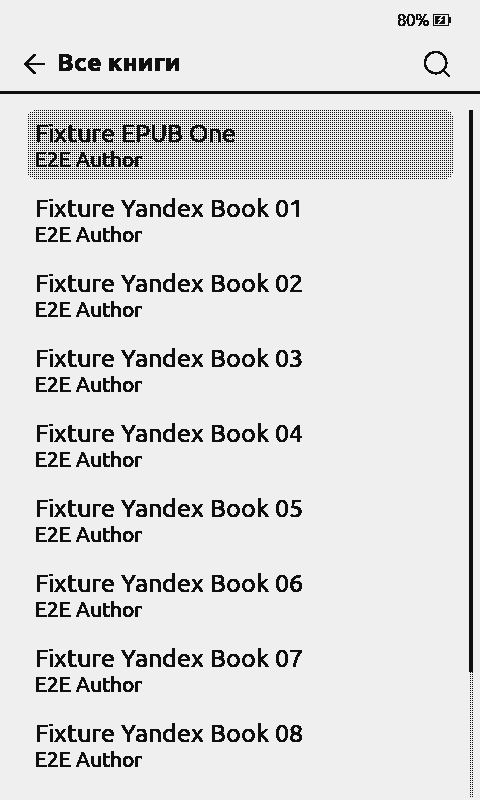
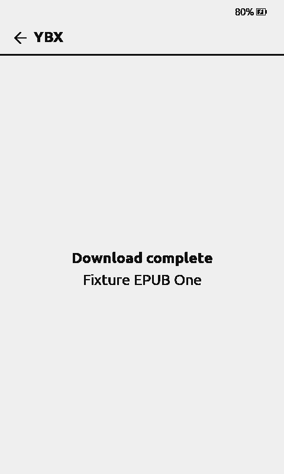
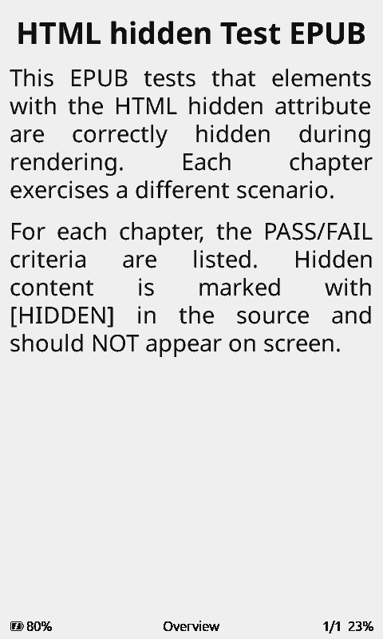
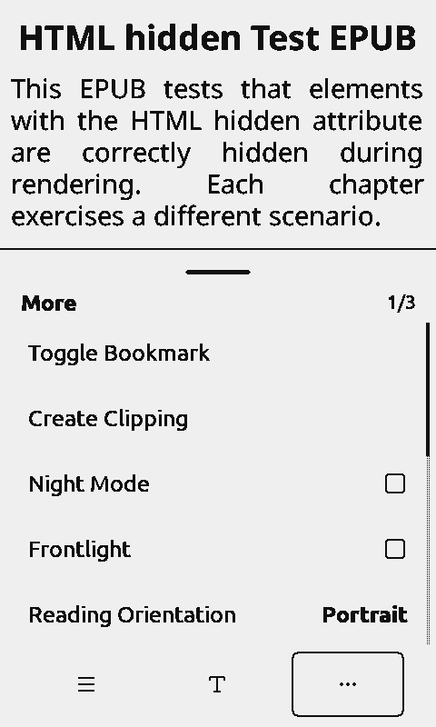

# 0110 — YBX Stock 1.6.14 RC1: real firmware, fully offline API E2E

**Date:** 2026-11-04. **Firmware:** unmodified official Stock CrossPoint
2.0 RC X4 Pro (16 MiB real flash image), eink-qemu 0.9.2 / QEMU 11.1.2.
**Runtime:** isolated Docker container with QMP/virtual GT911/UC8279 and
128 MiB MBR/FAT16. **Public source tag:** YBX Stock
[v1.6.14-rc.1](https://github.com/jhdvp/ybx-crosspoint-plugin/releases/tag/v1.6.14-rc.1).

This is a **real full guest firmware I/O run** against a **local
synthetic backend**. It does *not* use a real Yandex/WB/LitRes account.
It must not be confused with a live production or hardware QA pass.

## Test split and isolation

- Guest uses Stock plugin manifest/version/files 1.6.14 but on the
  **disposable test SD only**, every `https://my.ybx.app` address in
  `device.json` was redirected to the local fake service
  `http://10.0.2.2:18085`. This deliberately does not exercise production
  server TLS, real cloud device pairing or upstream bookstore entitlement.
- Fixture `stock1614_fixture_server.py` ran inside the same Docker
  container as QEMU; QEMU user networking connects only to its private
  slirp host alias. No mock port is published on the host or Internet.
  No user tokens, accounts or private EPUB files ever entered the run.
- Guest test Wi-Fi is `PICSimLabWifi`, QEMU emulated networking; the
  EPUB was an existing **public development-test fixture**
  (`test_hidden.epub`). The book source names in the fixture are fake.
- Device/keyboard interaction was through genuine QMP-generated GT911
  touch input and the real on-device screens, not a DOM simulation.

## Verified end-to-end

| Scenario | Observed evidence | Result |
| --- | --- | --- |
| Boot / SD mount / Wi-Fi | Official firmware on emulated X4 Pro mounts real FAT16 and connects to emulated Wi-Fi | PASS |
| QR/device-code protocol | Guest POST `auth/device` and `auth/token` get 200, token saved to `/plugins/ybx/token.json` | PASS, synthetic service |
| Static menu | All eight 1.6.14 folders visible on genuine firmware, separately documented in public stock PR | PASS |
| Catalog | Guest GET `/api/v1/crosspoint/catalog/all` gets 200; actual item title/author render on E-Ink | PASS, synthetic items |
| EPUB detail and Fetch | Guest GET `/books/upload:fixture-1/download` returns 200 | PASS |
| Physical guest SD writes | `/books/ybx/upload_fixture-1 - Fixture EPUB One.epub` is a CRC-valid ZIP and **byte-identical** to test EPUB | PASS |
| EPUB metadata sidecar | `.epub.meta.json` next to downloaded file contains `book_id=upload:fixture-1`, `provider=ybx` | PASS |
| Local config and token | Config values unchanged and fake token saved on guest SD | PASS |
| Reboot with persisted SD | Booted official firmware again, catalog GET 200 with **zero further** device-code/token exchanges | PASS |
| EPUB reader | Native Library finds actual downloaded file and renders its real XHTML page on UC8279 after reboot | PASS |
| File-level downgrade/upgrade | Replaced public files 1.6.14→1.6.13→1.6.14 in **disposable mounted FAT16 image**; SHA-256 of token/config/KoSync/settings/EPUB/sidecar unchanged | PASS, file-level only |
| Server fixture protocol | Independent local `unittest` probes auth, paging, search, EPUB, no-token 401, KoSync/clippings v2 GET/PUT | PASS, 2 tests |
| Real Cloud YBX OAuth/providers | Did not attach live user account or real provider | NOT TESTED |
| Reader-triggered ClippingSync | KOReader fixture config `syncClippings=true` installed on a separate isolated SD; More→Create Clipping attempted but no firmware ClippingSync HTTP requests observed. Cannot claim successful quote upload | NOT VERIFIED |
| In-page JS WebUI update and rollback | Only **manual file-level** rollback/update verified; the full browser updater's host APIs were not driven | NOT VERIFIED |
| Physical boards, GPIO/power, security | Simulation only; no physical ESP32 hardware acceptance | NOT VERIFIED |

### Real emulated e-paper frames

**Catalog** with data loaded via the mock server, after real device-code
and token exchange:



**Download** acknowledged by the original firmware after receiving the
real binary EPUB from fake server:



**Reboot** preserved token. No new fake OAuth exchange; book catalog still loads:


**Native reader** opens the downloaded EPUB after reboot:



The 2.0 More menu exposes Create Clipping, but QA did not complete a
clipping selection or the succeeding `Sync Progress` menu action.
This is a remaining **UI automation blocker**, not a passed test:



## Reproduce protocol fixture safely

From `tools/ybx-system-emu/`:

```sh
python3 -m unittest -v test_stock1614_fixture_server.py
```

For a guest run, first create an isolated FAT16 image and install the
public Stock 1.6.14 RC into `/plugins/ybx/`. Apply a **disposable-card-only**
rewrite of every `https://my.ybx.app` URL in `device.json` to
`http://10.0.2.2:18085`, preserve all other runtime fields, enable
Plugins and disable auto-sleep on this disposable card.

Invoke the existing **pinned** `start_eink_qemu11_preview.sh` with
`YBX_QEMU11_FLASH` pointing at the official 16MiB X4 Pro flash,
`YBX_QEMU11_SD` at the isolated test card, distinct 88xx preview/QMP
ports and a fresh `YBX_QEMU11_WORKDIR`. Copy a *public test* EPUB to
`$YBX_QEMU11_WORKDIR/mock.epub`, then copy
`stock1614_fixture_server.py` into the new QEMU Docker container and
launch it there as an isolated Python process. Port 18085 must remain
private to that container.

All evidence and guest SD images from 2026-11-04 are retained locally
under `~/Projects/YBX/artifacts/ybx-stock-1614-qa/fully-mocked-20261104/`.
The three isolated guest QEMU instances were stopped after capture.
Stable QEMU 8784, real YBX Server production, actual reader SD, and
YBX Native firmware were not modified.

**Release gate:** Keep public PR #14 and staged server payload PR #36
in Draft; the pinned 1.6.14 prerelease is a testing candidate only.
A real Live account / real device acceptance still requires the
user's actual hardware. Do not claim a successful live LitRes/WB EPUB
entitlement, clipping upload, or physical firmware upgrade based on this
isolated mock run.
