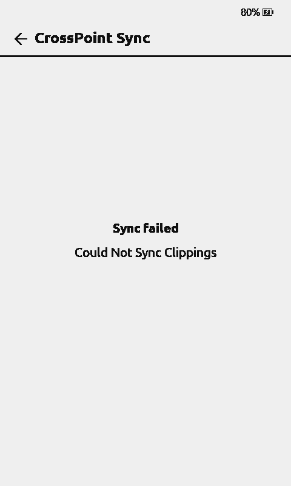
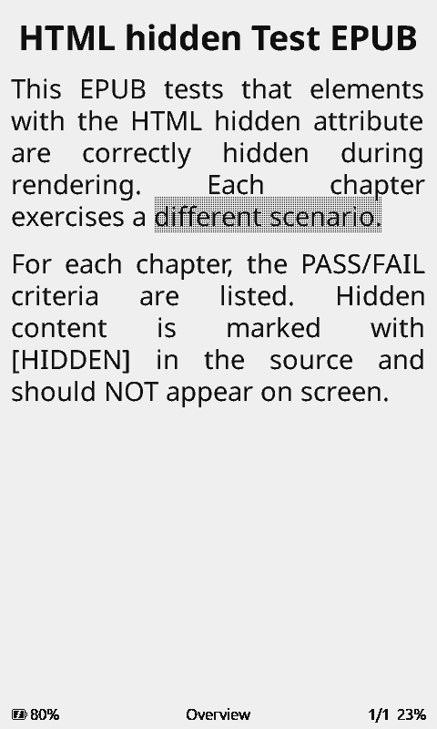

# 0111 — Stock CrossPoint: real guest Clippings v2 round-trip

2026-11-04. Tested on **original Stock CrossPoint 2.0 RC X4Pro firmware**
in QEMU 11.1.2, real guest input/SD/MMC/E-Ink, fully synthetic offline
YBX API at 10.0.2.2:18085. No private accounts, books, or hardware involved.

## Device-initiated results

1. Opened real EPUB using the original reader. Via More → Create Clipping,
   selected the word **different**, tapped Clip. Firmware displayed
   View Clippings and its new clipping containing **different**.
2. Connected the guest to simulated PICSimLabWifi and invoked Sync Progress.
   Firmware sent GET → PUT → GET at the **Clippings v2** endpoint (HTTP 200);
   with the deliberately incomplete early fixture response, UART showed
   Invalid remote clipping and on-device **Could Not Sync Clippings**.
   This was a **fixture problem**, not proven to be a production bug:
   early fixture returned raw PUT data without numeric deleted and revision.
3. Aligned synthetic service with production server clipping.py and device
   ClippingSync.cpp: monotonic revision per document, numeric deleted,
   full required fields, one-item cursor pagination, idempotent PUT and
   seeded restart. **No firmware changes** were made.
4. Rebooted actual guest with preserved FAT16. Firmware received valid
   Clippings v2 GET responses, synced successfully, attempted progress GET
   and sent progress PUT (HTTP 200); it returned to the reader.
5. Made second clipping **scenario.** through real reader UI. Device
   performed GET → PUT → GET → GET; synthetic server stored independent
   rows **different (revision 1)** and **scenario. (revision 2)**.
   It returned both by cursor; reader subsequently sent progress PUT (200),
   returned to the book and did not log another Clippings decode error.

See exact synthetic HTTP events and row revisions:
[guest-http-evidence.json](../evidence/stock1614-clippings/guest-http-evidence.json).
No auth credentials or live provider identifiers are logged.

## Tests and honest limitations

The corrected **stock1614_fixture_server.py** and its protocol tests check
required integer fields, revision/cursor, one-item pages, idempotent PUT,
invalid payload rejection and auth isolation. The new **guest verdict
tests** do not accept a mock-only round trip: a passing E2E verdict needs
device-originated GET→PUT→GET plus a KoSync progress PUT, stored rows, and
the expected clipping. There are 10 targeted Python tests passing.

An experimental **run_stock1614_clippings_guest.py** provides actual QMP
touch/UI-state checks for reproducibility. **This ONE-CLICK AUTORUN IS NOT
YET GREEN**: Reader→More overlay is intermittently missed under QEMU's
accelerated asynchronous EPD refresh. The genuine guest's manually driven
full Clippings exchange above **did** pass. Do not claim full automated UI
acceptance from this runner until this last input gate is reproducible.

Other regression results: emulator **993 tests, 10 skipped**; Stock plugin
**13 Python + 48 Node**; server payload API **73 pass, 62 skipped**.
No tests touched production YBX, the user's actual reader, paid content
or the unrelated YBX Native firmware.

**Still pending before an unrestricted stable rollout:** physical reader
acceptance (especially older CrossPoint 1.6.5), real user account KoSync,
production TLS and third-party provider downloads, WebUI live installer,
hardware wake/sleep and real SD state rollback.
